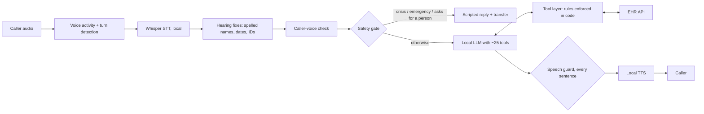
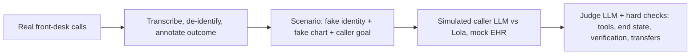

# Lola — a local AI phone receptionist for a psychiatric practice

**Status:** prototype on an internal test line, with a read-only pilot on the production phone system planned. Source private.

Lola answers calls for a psychiatric practice in English and Spanish. She verifies callers, reschedules and books visits, takes refill requests and provider messages, answers office questions, and transfers to staff when she can't help. Every AI model — speech recognition, the language model and speech synthesis — runs on a single Mac Studio (Apple Silicon, 36 GB). Audio and transcripts never leave the machine.

## Why it's hard

A psychiatric front desk receives calls from people in crisis, from family members of elderly patients, and from callers who are confused, upset or hard to hear. A language model that is pleasant 95% of the time can still do real harm in the remaining 5%. The design question was how to get the usefulness of an LLM without trusting it with anything that matters.

## Design principles

1. **The model talks; the code decides.** Identity checks, what may be shared, which slots may be booked, crisis handling and "did we actually do it?" are enforced in deterministic Python. The LLM chooses words and which tool to call, and tools refuse invalid actions.
2. **Fail toward a human.** When Lola is unsure, loops, or hits something her tools can't do, she transfers to the front desk or takes a message for the provider.
3. **Local first.** No patient audio or transcript is sent to a cloud model.
4. **Measured, not assumed.** Every change is checked on simulated calls built from real front-desk calls, with a held-out set.

## Architecture

- **Speech in:** Whisper large-v3-turbo on Apple Silicon, with vocabulary hints for provider names and medications, plus code that reassembles spelled names, dates and phone numbers.
- **Brain:** a local mixture-of-experts LLM (about 3B active parameters) served by Ollama, chosen by a bake-off (below).
- **Speech out:** local neural TTS, with separate English and Spanish voices. A typical caller waits about 0.8–1.0 seconds after they stop talking.

## Safety layers around the model

**Before the model, on every caller utterance:**

- Crisis language (suicide, self-harm, harm to others, overdose) **never reaches the LLM.** A verified patient triggers an urgent case to their clinician, 911/ER guidance and a transfer to staff. The crisis rules, including what is *not* a crisis ("this headache is killing me", "emergency refill"), were set and reviewed clinically.
- A request to speak to a person is honored immediately.
- Callers who are not the patient (family, pharmacies, insurers) get restricted handling.

**After the model, on every sentence before it is spoken:**

- **Unbacked claims:** "you're booked" or "I've sent that" without the matching successful tool call is regenerated or replaced.
- **Promises without action:** "I'll let your provider know" with no matching request is caught.
- **Hallucinated facts:** invented dollar amounts, provider names not on the roster and impossible dates ("Monday the 13th" when the 13th is a Tuesday) are blocked.
- **Loops:** repeated or alternating replies trigger a nudge, then a hand-off to staff.

**In the tools:** nothing chart-related works before name and date-of-birth verification. Only slots actually offered on the call can be booked, and every booking needs a read-back and an explicit "yes".

## Evaluation

- **Splits:** a 105-call development set, a 94-call "fresh" set never tuned on, and a sealed hold-out set.
- **Determinism:** all agents run at temperature 0. Two identical runs differ by about one call in 94.
- **Separation:** the model under test runs alone on one machine; the simulated caller and judge run on a second machine, so they don't compete for memory or speed.

**Model bake-off** (same code and harness for every model; calls passed out of 94 fresh and 105 development):

| Model | Fresh /94 | Dev /105 | Total /199 | Spanish /12 | Typical wait |
|---|---|---|---|---|---|
| GLM-4.7-Flash | 68 | 80 | **148** | 9 | 1.0 s |
| Qwen 3.6 35B-A3B | 69 | 76 | 145 | 7 | 0.8 s |
| Gemma 4 26B-A4B | 69 | 74 | 143 | 7 | 0.8 s |
| gpt-oss-20b | 39 | – | – | – | 1.5 s |

The margins between the top three are small, and I treat them that way. About 11 fresh calls fail with every model, often because the grader and the scenario disagree, which is itself a finding about the evaluation.

## What I learned

- **Prompts are not controls.** The most important behaviors moved from the prompt into code as soon as they mattered, and the policy document records where each rule is enforced.
- **Clinical judgment belongs in the safety layer.** Deciding what counts as a crisis, and what doesn't, is a clinical call. Over-inclusive lists are safe but transfer too much; under-inclusive lists are dangerous.
- **Evaluations have their own failure modes.** Simulated callers drift, judges disagree with scenarios, and fixing the harness can change scores as much as fixing the agent.
