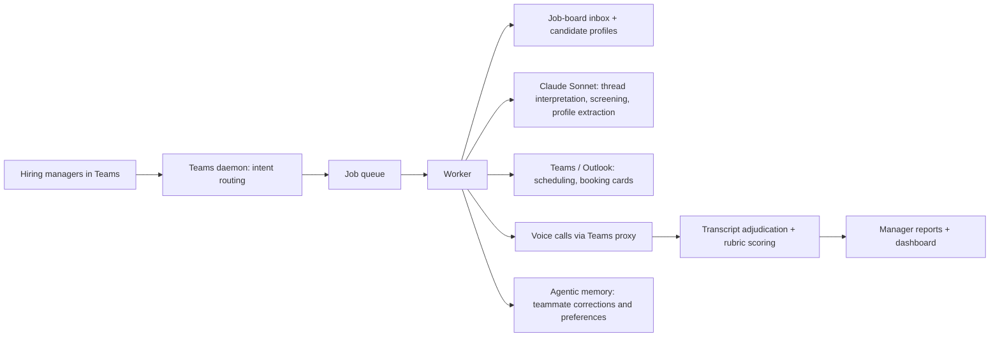

# Lola HR — an autonomous recruiting agent

**Status:** in live use for clinical and administrative hiring across two companies. Source private.

Lola HR runs the recruiting pipeline for a multi-site psychiatric practice and its parent company. She reads the job-board inbox, screens candidates against role-specific rubrics, messages candidates, coordinates interviews through Microsoft Teams and Outlook, places and adjudicates phone calls, scores interview transcripts, and reports to hiring managers. Hiring managers direct her in plain language from Teams.

## Architecture

- **Claude Sonnet** on the live path for inbox interpretation, candidate screening, profile extraction and transcript scoring, with a local model as fallback.
- **Deterministic gates around the model:** required screener questions are hard gates, numeric requirements are minimum thresholds, and role rubrics are explicit and versioned.
- **Agentic memory:** Lola learns from teammate corrections and preferences. Releases are named, and the pre-memory baseline is kept so behavior can be compared or rolled back.
- **Operations:** a watchdog every 10 minutes, nightly backups and an encrypted off-machine recovery bundle every week.

## Guardrails that came from real failures

- **Self-correction is ordered.** If Lola accepted a candidate and later finds a failed required screener, she corrects the record first and then sends an apology and explanation.
- **Human overrides stick.** When a manager has materially decided on a candidate, that decision is recorded so later scans don't silently reopen it.
- **No nagging.** Lola waits at least 48 hours before repeating a request to a candidate unless they reply with something new.
- **Staged rollout.** Voice calling is manager-triggered by default, and live tests can be limited to a single candidate and the real managers for that candidate only.

## What I learned

Technically, the system did what it was designed to do. The deployment still hurt people. We introduced it without involving the staff whose work it changed, and it cost us trust and a valued team member. That is the most important lesson I've taken from building agents: **a system can succeed while its deployment fails**, and the gap between the two is about people, not code.

Two open questions I take seriously:

- **Fairness in automated screening.** An LLM applying a rubric at scale can encode bias quietly. Explicit rubrics and human overrides help, but they are not an audit.
- **Accountability for autonomous actions.** When an agent rejects or messages a candidate, the people affected deserve the same care and explanation a human recruiter would give.
